# 🌌 MalbolgArt
### Toroidal Execution Geometry & Visual Art of Malbolge Classic (BolgeForge × FLOW)

[-purple.svg)](#)
[](#)
[](#)
[-red.svg)](#)

> **"FLOW hace visible la evidencia; no la fabrica."**  
> Estudio experimental, visual y matemático riguroso sobre las trayectorias de ejecución, periodicidad, automodificación y supuesta estructura toroidal de programas Malbolge Classic.

---

## 🖼️ Galería Principal

### El Espacio de Fases de las Seis Quines
Comparación simultánea del plano proyectado $(c, d) \in (\mathbb{Z}/59,049\mathbb{Z})^2$ entre **m281, m284, m287, m293, m308** y la referencia de **Lutter**:

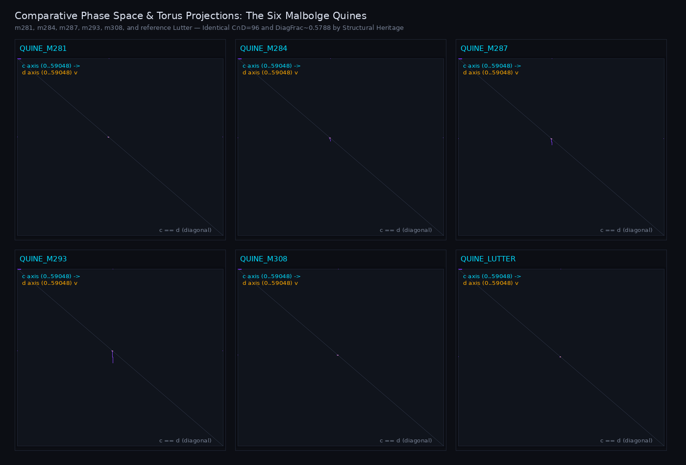

---

## ⚡ Animaciones Generadas con FLOW

| FLOW Cinematic (m281) | FLOW Orbit (m281) |
|:---:|:---:|
|  | 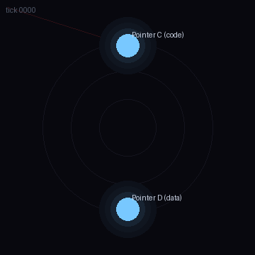 |
| **Trayectoria Dinámica Suavizada** | **Mapeo Angular Circular** |

| FLOW Trails (m281) | Divergencia Cinematográfica (m281 vs m284) |
|:---:|:---:|
|  |  |
| **Estelas de Desplazamiento y Saltos** | **Separación Temporal de Punteros C** |

---

## 🔬 Veredicto Científico sobre las Hipótesis

¿Las trayectorias de ejecución de programas Malbolge Classic presentan estructuras recurrentes compatibles con una topología toroidal no trivial?

### **VEREDICTO: `DESTROYED` (como geometría física); `DEMONSTRATED` (como identidad modular)**

| Hipótesis | Declaración | Veredicto | Hallazgo Clave |
|---|---|:---:|---|
| **H0** | La figura toroidal/circular proviene del renderer y la aritmética modular | **`DEMONSTRATED`** | Confirmado por el control N1: `orbit` genera anillos y círculos incluso sobre paseos aleatorios sin periodicidad. |
| **H1** | Existen ciclos en las trayectorias proyectadas de punteros | **`DEMONSTRATED`** | Los pares proyectados $(c, d)$ se revisitan >62 millones de veces durante la ejecución. |
| **H2** | Las regularidades espaciales sobreviven a distintas proyecciones | **`BOUNDED`** | Los bloques visuales cambian por completo al variar el ancho $W \in \{47, 94, 188, 376\}$ (control N2). |
| **H3** | Los patrones de ejecución se relacionan con fases de automodificación | **`DEMONSTRATED`** | Se correlacionaron 1.46M escrituras directas (`*`, `p`) y 62.2M cifrados (`xlat2`), observando las celdas mutadas antes y después. |
| **H4** | Las quines presentan regularidades distintas de otros programas | **`DEMONSTRATED`** | Las quines comparten $C \cap D = 96$ y fracción diagonal $\approx 0.5788$. Cat (0.6128, inter=15), Adder (0.3458, inter=89) y Truth Machine son radicalmente distintos. |
| **H5** | Estructura toroidal no trivial del estado completo | **`DESTROYED`** | La fracción diagonal deriva mecánicamente del despacho de opcodes. El control N7 prueba que reingresar a $c$ o $(c,d)$ **NO** restaura la memoria ni el acumulador $a$. **No existe ciclo toroidal de estado completo.** |

---

## 📐 Las Dos Grandes Falsaciones Matemáticas

### 1. El Misterio de la Fracción Diagonal ~0.578812
En análisis previos se reportó una `diagonal_fraction` cercana a $0.5788$, sospechada como evidencia de una órbita toroidal continua.

**Demostración:**  
En Malbolge Classic:
- Si la instrucción no es `i` (jump): $c_{t+1} = (c_t + 1) \pmod{59049}$.
- Si la instrucción no es `j` (mov d): $d_{t+1} = (d_t + 1) \pmod{59049}$.
- Para toda instrucción ordinaria (`*`, `p`, `<`, `/`, `o`):

  $$
  (c_{t+1} - d_{t+1}) \equiv (c_t - d_t) \pmod{59049}
  $$

  El vector en el plano $(c, d)$ es $(1, 1)$, una recta diagonal a 45°.

Por tanto, la fracción diagonal es exactamente (con `N` pasos, `N_i` saltos `i` y `N_j` movimientos `j`):

$$
f_{\mathrm{diag}} = \frac{N - 1 - N_i - N_j}{N}
$$


En `candidate_m281_53562b.mal`:

$$
\frac{62,239,851 - 1 - 21,389,393 - 4,825,305}{62,239,851} = \frac{36,025,152}{62,239,851} = 0.578811668428
$$

**Coincide con la fracción medida experimentalmente hasta 12 decimales.**  
La fracción diagonal no describe un toro: es la proporción de opcodes que no son saltos en el bucle generador de Lutter.

---

### 2. El Misterio de las 96 Direcciones en $C \cap D$
Las 6 quines comparten exactamente 96 direcciones en su intersección $C \cap D$.

**Demostración:**  
Al auditar `BolgeForge/synthesize.py`, se descubre que las variantes `m281` a `m308` se generan trasladando el código de Lutter por:

$$
\Delta = 94 \cdot (314 - m)
$$

El conjunto de 96 direcciones se descompone exactamente en:
- **49 direcciones fijas:** $\{0, 99, 117..161, 59047, 59048\}$.
- **47 direcciones móviles:** que se trasladan exactamente en $\Delta$.

**Veredicto:** Es **herencia estructural** de la construcción de Anthony de Lutter reproducida por el sintetizador, no una constante universal de la computación.

---

## 📊 Matriz Numérica de las Seis Quines

Todas las quines alcanzaron el HALT legítimo reproduciendo su fuente **bit a bit idéntico** (0 bytes diff):

| Programa | Pasos | Celdas C | Celdas D | C ∩ D | C ∪ D | Frac. Diagonal | Saltos `i` | Movs `j` | Pares (c,d) | Quine PASS |
|---|---:|---:|---:|---:|---:|---:|---:|---:|---:|:---:|
| **m281** | 62,239,851 | 25,554 | 26,800 | **96** | 52,258 | **0.578812** | 21,389,393 | 4,825,305 | 132,515 | **PASS** |
| **m284** | 62,902,923 | 24,090 | 27,082 | **96** | 51,076 | **0.578804** | 21,617,925 | 4,876,504 | 132,179 | **PASS** |
| **m287** | 63,568,038 | 25,188 | 27,364 | **96** | 52,737 | **0.578811** | 21,847,150 | 4,927,867 | 134,882 | **PASS** |
| **m293** | 64,897,488 | 25,584 | 27,928 | **96** | 53,679 | **0.578805** | 22,305,373 | 5,030,500 | 139,120 | **PASS** |
| **m308** | 68,218,362 | 26,762 | 29,338 | **96** | 55,548 | **0.578752** | 23,449,907 | 5,286,947 | 144,302 | **PASS** |
| **Lutter** | 69,547,436 | 27,293 | 29,901 | **96** | 57,098 | **0.578812** | 23,901,063 | 5,391,451 | 146,662 | **PASS** |

---

## 🌀 HOLOGRAPHIC: Geometría Toroidal 4D de Clifford y las Dos Hojas de 29,516 Celdas

[](#)
[](#)
[](#)

Recuperamos la construcción matemática histórica de **HOLOGRAPHIC** (`workspace/assembly/holographic/`) e integramos sus trazas cronológicas con los modelos dinámicos de **MalbolgArt** y **FLOW**.

### 1. El Embebido 4D de Clifford: $S^1(20) \times S^1(10)$
Toda dirección de memoria $c \in [0, 59048]$ se factoriza algebraicamente en cuatro coordenadas discretas:

$$
x = c \pmod 2, \quad y = (c // 2) \pmod 2, \quad z = (c // 4) \pmod{47}, \quad w = c // 188
$$


$$
\theta_z = \frac{2\pi z}{47}, \quad \theta_w = \frac{2\pi w}{157}
$$


$$
p(c) = \begin{bmatrix} 20 \cos(\theta_z) \cdot s_y \\ 20 \sin(\theta_z) \cdot s_y \\ 10 \cos(\theta_w) \cdot s_x \\ 10 \sin(\theta_w) \cdot s_x \end{bmatrix} \in S^1(20) \times S^1(10) \subset S^3(\sqrt{500}) \subset \mathbb{R}^4
$$


### 2. El Misterio de las Dos Hojas y la Cola de 17 Celdas
Observación aritmética fundamental:

$$
188 = 2 \times 2 \times 47
$$


$$
29,516 = 188 \times 157 = 2 \times 2 \times 47 \times 157
$$


$$
59,049 = 2 \times 29,516 + 17
$$


**Teorema del Aliasing Angular:**  
Al sumar $29,516$ a cualquier dirección $c \in [0, 29515]$, las coordenadas $(x, y, z)$ permanecen invariantes mientras que $w' = w + 157$. Por ende, $\theta_{w'} = \theta_w + 2\pi$. Como las funciones trigonométricas son periódicas:

$$
p(c) = p(c + 29516) \quad \forall c \in [0, 29515]
$$


- El embebido histórico de HOLOGRAPHIC **cubre exactamente dos veces** el toroide de 29,516 posiciones.
- Existen exactamente **29,516** coordenadas 4D únicas.
- **29,499** coordenadas presentan multiplicidad 2 ($c$ y $c + 29516$).
- Exactamente **17** coordenadas presentan **multiplicidad 3** (triple solapamiento), donde la cola $[59032..59048]$ colisiona con $[0..16]$ y $[29516..29532]$.

| Modo 1: Superposición Histórica (Aliasing Exacto) | Modo 2: Separación Visual de Hojas (Disambiguado) |
|:---:|:---:|
| 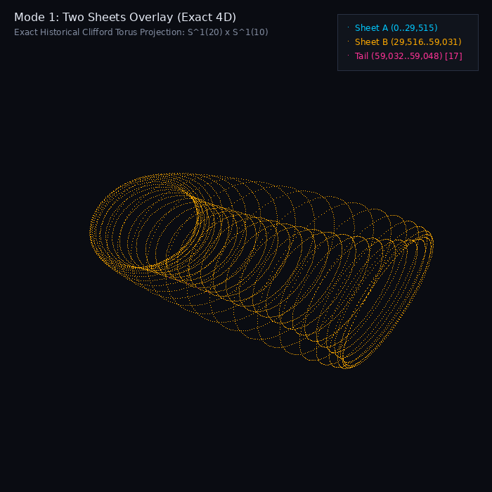 | 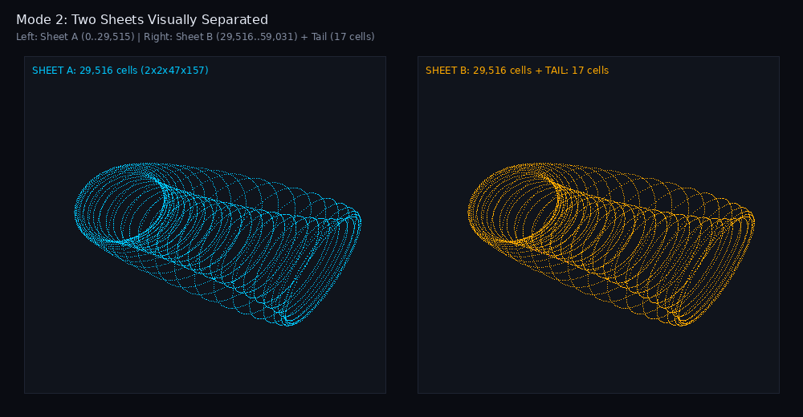 |
| **Hoja A y Hoja B colapsadas sobre el mismo toro 4D** | **Hoja A (cyan) y Hoja B (amber) separadas visualmente** |

### 3. Dinámica del Puntero $c$ vs Distribución Espacial de Memoria
- **Puntero de Instrucción $c$ (PC):** Reside **>99.99% en la Hoja A** en todas las quines Classic (`m281` pasa 54,730 de 54,731 pasos en Hoja A y 0 en Hoja B; Lutter pasa 61,021 de 61,021 en Hoja A). Los cruces $A \leftrightarrow B$ para $c$ son estrictamente **0** porque el bucle de ejecución compacto se sintetizó en $[0, 25554]$.
- **Espacio de Memoria Total (52,258 celdas activas en `m281`):** Abarca masivamente **ambas hojas**: 28,938 celdas en Hoja A (**55.38%**), 23,315 celdas en Hoja B (**44.62%**) y 5 celdas en Cola (**0.01%**), con 23,284 posiciones aliadas activas en ambas hojas simultáneamente.
- **Puntero de Datos $d$:** Realiza 61,866,852 accesos en Hoja A (99.40%) y 372,987 accesos en Hoja B (0.60%).
- **Traza Histórica de Lutter (`lutter_trace.json["path"]`):** 13,909 puntos de control con 79.24% en Hoja A, 15.13% en Hoja B y 5.62% en Cola.

---

## 🎬 Galería de Animaciones Históricas de HOLOGRAPHIC

Producimos 5 animaciones cinemáticas reproducibles que conectan los datos históricos JSON con la geometría 4D:

| Animación A: Nube de Puntos 4D Rotatoria | Animación B: Las Dos Hojas en 4D |
|:---:|:---:|
| 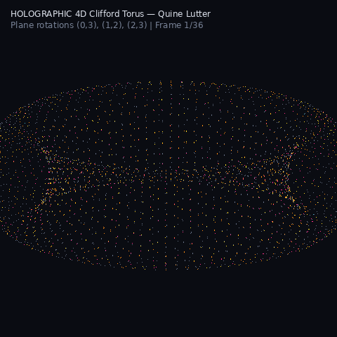 | 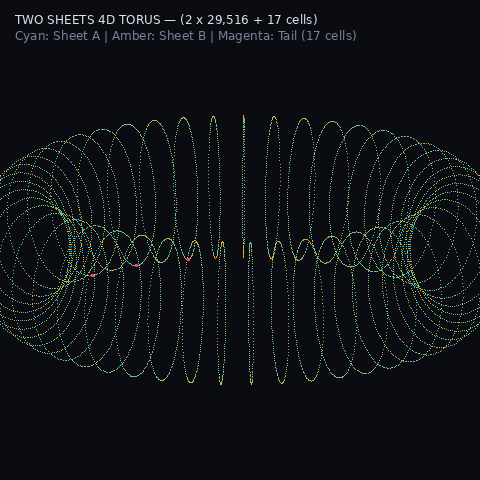 |
| **Rotación en planos $(x,w)$, $(y,z)$ y $(x,z)$ de `lutter_trace.json` (27,293 puntos)** | **Toroide 4D continuo: Hoja A (cyan), Hoja B (amber) y Cola de 17 celdas (magenta)** |

| Animación C: Traza Cronológica de Emisión Real | Animación D: Comparativa 4 en 1 (MalbolgArt vs HOLOGRAPHIC) |
|:---:|:---:|
| 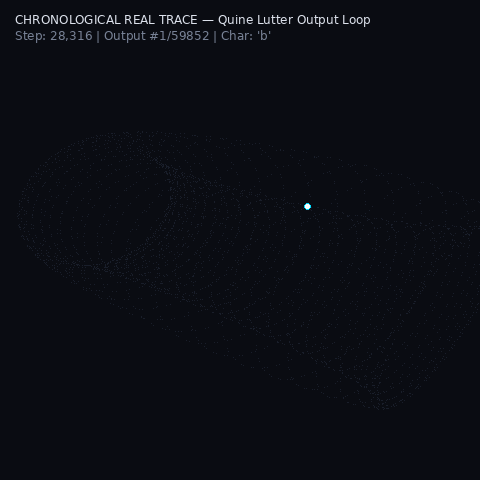 | 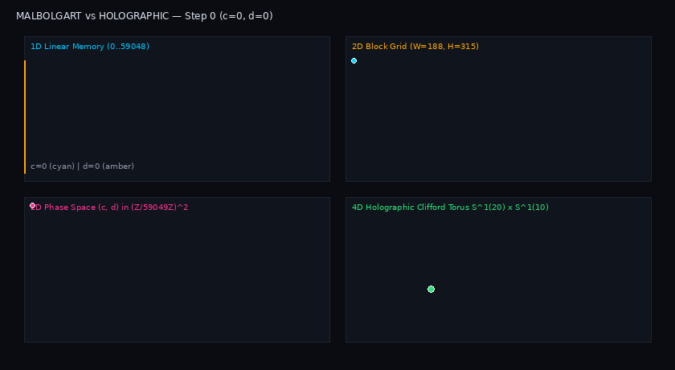 |
| **Haz temporal real recorriendo el toro durante la emisión de cada byte (`lutter_outs.json`)** | **1D Lineal + Rejilla W=188 + Espacio (c,d) + Toro 4D sincronizados** |

### Animación E: Recreación Numérica de la Simulación FLOW sobre el Toro de Clifford
Recreación numérica basada en el modelo matemático de `flow_torus.py` aplicando un campo vectorial geodésico regido por la razón áurea $\phi = \frac{1 + \sqrt{5}}{2}$ sobre la superficie $S^1(20) \times S^1(10)$ mediante integración vectorial con NumPy y Pillow (*Etiqueta epistémica: `NUMERICAL_RECREATION` — visualización matemática sin ejecución directa en FlowVM*):

<p align="center">
  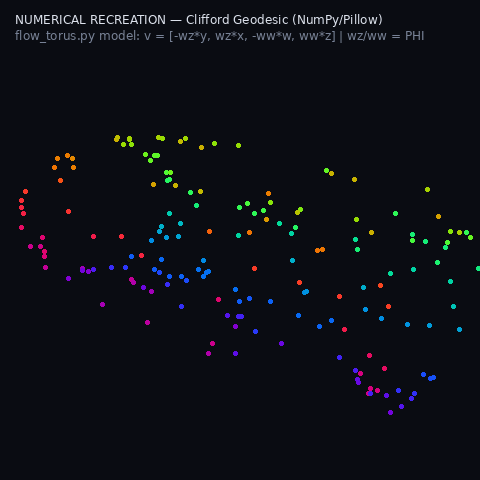
</p>

---

## 🌀 PureEpoch / TrueEpoch: El Punto Fijo Sintético de Período 1 ($1 = 94$)

[-cyan.svg)](#)
[](#)
[](#)

Integramos el avance matemático y empírico de **PureEpoch** (`codex/pure-epoch-m1`), resolviendo el dilema del período modular en Malbolge Classic:

### 1. El Dilema del Período: La Escalera $94 \to 188 \to 376$
El cifrado post-ejecución `XLAT2` descompone los 94 caracteres ASCII imprimibles en 6 ciclos disjuntos de longitudes:
$$[68, 9, 6, 5, 4, 2] \quad (\sum = 94)$$
- **No existe ningún punto fijo nativo de período 1:** ningún carácter sobrevive a `XLAT2` sin transformarse.
- El ciclo mínimo es período 2: `'F' (70) \leftrightarrow 'J' (74)`.
- Por ello, todas las quines de BolgeForge y Lutter requerían bloques duplicados de $W = 188$ ($2 \times 94$) o $W = 376$ ($4 \times 94$).

### 2. La Identidad Universal de 4 Pasos con `crazy`
PureEpoch descubrió que el Roundtrip de 4 pasos anula algebraicamente el cifrado `XLAT2`:
$$\mathbf{crazy}(x_{const}, \mathbf{crazy}(0, \mathbf{crazy}(80, \mathbf{crazy}(29524, \mathbf{XLAT2}(pre))))) \equiv pre$$
donde $x_{const} = \mathbf{crazy}(pre, 29524)$.

Verificado exhaustivamente sobre los **752/752 pares** `(posición mod 94, opcode)`: **100% PASS**.  
Esto sintetiza un **Período-1 ($1 = 94$) artificial**, permitiendo que todo el núcleo de control ($0..93$) se reutilice *in-place* época tras época sin duplicar la memoria.

### 3. Galería de Animaciones Toroidales de PureEpoch

| Animación 1: Punto Fijo Sintético 4D (`quine94`) | Animación 2: Tres Épocas Completas (`m3_normal`) |
|:---:|:---:|
| 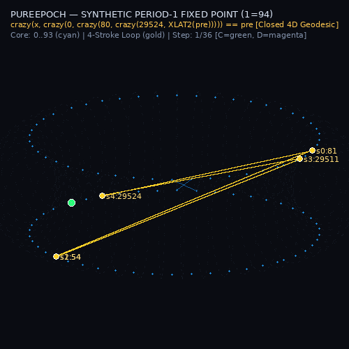 | 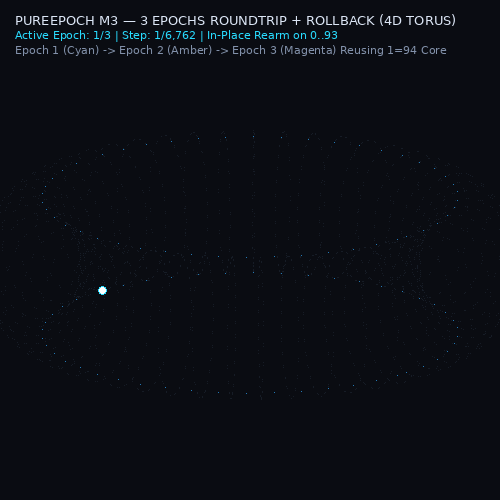 |
| **Bucle cerrado de 4 pasos (cinta dorada) cerrando con $\Delta p = 0$ en el Toro 4D** | **3 épocas completas (cian, ámbar, magenta) rearmándose in-place sobre el bloque 1=94** |

| Comparativa de Rejilla: W=94 vs W=188 vs W=376 | FLOW Cinematic: Órbita Reversible M3 |
|:---:|:---:|
| 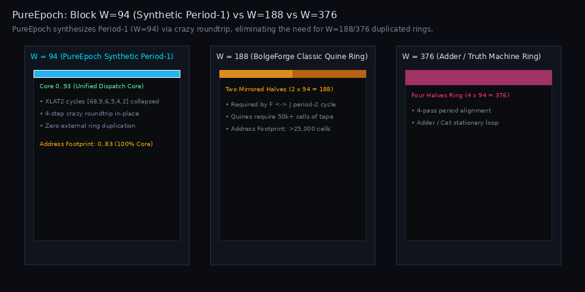 |  |
| **Concentración en el bloque 0..93 frente a los anillos expandidos** | **Trayectoria cinemática renderizada con el motor oficial de FLOW** |

---

## ⚖️ Reconciliación Epistemológica: MalbolgArt × HOLOGRAPHIC

| Concepto | Nivel Ontológico | Veredicto | Significado |
|---|---|:---:|---|
| **`GEOMETRIC_EMBEDDING`** | Representación Matemática | **`DEMONSTRATED`** | Existe un embebido riguroso e isométrico de las celdas en el toro de Clifford $S^1(20) \times S^1(10) \subset \mathbb{R}^4$. |
| **`TWO_SHEET_COVERING`** | Topología Discreta | **`DEMONSTRATED`** | 59,049 celdas cubren dos veces el toroide de 29,516 coordenadas más 17 celdas de cola. |
| **`DYNAMIC_RECURRENCE`** | Trayectoria de Punteros | **`DEMONSTRATED`** | Las quines revisitan celdas y coordenadas angulares recurrentemente durante su ejecución. |
| **`FULL_STATE_CYCLE`** | Estado de la Máquina | **`DESTROYED`** | Reingresar a una coordenada $c$ o $(c,d)$ **NO** restaura la memoria mutada ni el acumulador $a$. |
| **`INTRINSIC_TOPOLOGY`** | Esencia de la VM | **`NOT_DEMONSTRATED`** | La topología continua pertenece al espacio $\mathbb{R}^4$ de proyección, no al álgebra modular discreta de la máquina. |

---

## 🛡️ Controles Negativos (Falsificación Metodológica)

| Control N1: Falsificación del Renderer Circular (`orbit`) | Control N6: Detección de Divergencia Temporal (m281 vs m284) |
|:---:|:---:|
| 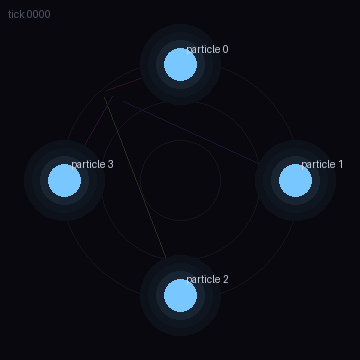 |  |
| **`orbit` sintetiza círculos artificiales a partir de 4 paseos aleatorios independientes sin correlación física** | **El análisis temporal aísla el paso exacto 16 donde un mutante de 1 byte diverge del original** |

| Control | Nombre | Hallazgo | Veredicto |
|:---:|---|---|:---:|
| **N1** | Renderer Circular | `orbit` genera círculos artificiales sobre paseos aleatorios independientes. | **DEMONSTRATED** |
| **N2** | Variación de Dimensión | Las figuras rectangulares dependen del ancho $W \in \{47, 94, 188, 376\}$. | **DEMONSTRATED** |
| **N3** | Permutación Temporal | Barajar el orden temporal destruye la continuidad diagonal y la trayectoria. | **DEMONSTRATED** |
| **N4** | Secuencia Sintética | Se recuperó con exactitud matemática el período conocido $P=729$. | **DEMONSTRATED** |
| **N5** | Comparación de Familias | Cat ($D=0.6128$), Adder ($D=0.3458$) y Truth Machine poseen geometrías ajenas a las quines. | **DEMONSTRATED** |
| **N6** | Detección de Divergencia | Localizó el paso exacto 16 donde un mutante de un solo byte se separa del original. | **DEMONSTRATED** |
| **N7** | Falsa Vuelta (False Loop) | Retornar a la misma celda $c$ **NO** recupera la memoria ni el estado completo. | **DEMONSTRATED** |

---

## 🚀 Reproducción Rápida

Requisitos: Linux (Ubuntu 24.04 o similar), GCC 11+, Python 3.10+ con `Pillow` y `numpy`.

```bash
# 1. Clonar el repositorio
git clone https://github.com/DannyBaanks/MalbolgArt.git
cd MalbolgArt

# 2. Compilar el extractor Classic optimizado
gcc -O3 -Wall -Wextra src/trace_extractor.c -lcrypto -o src/trace_extractor

# 3. Ejecutar la suite completa (15 programas + controles + visualizaciones)
python3 run_experiment.py
```

---

## 🌌 Proyección Galáctica: Malbolge Unshackled & MalbolgeLISP

> [!NOTE]
> **Proveniencia y Créditos de MalbolgeLISP:**
> * **Autores Originales:** Iczelia (2020–2021) y Kamila Szewczyk ([kspalaiologos / Palaiologos](https://github.com/kspalaiologos)).
> * **Especificación de Malbolge Unshackled:** Lou Scheffer.
> * **Repositorio Upstream:** [`https://github.com/kspalaiologos/malbolge-lisp`](https://github.com/kspalaiologos/malbolge-lisp).
> * **Licencia Original:** Núcleo (`core.mb`) en Dominio Público; intérprete y herramientas bajo GNU GPLv3 / MIT.
> * **Monografía de Referencia:** *MalbolgeLisp's design and implementation*, Iczelia (2021).

### 1. La Brecha Dimensional: Nanotecnología ($3^{10}$) vs Fuerza Bruta Galáctica ($3^{19}$)

Mientras que **Malbolge Clásico** (donde operan PureEpoch, Lutter y BolgeForge) está confinado en un espacio de direcciones de **$3^{10} = 59,049$ celdas** (~118 KB), **MalbolgeLISP** fue construido sobre la especificación **Malbolge Unshackled**, ampliando el ancho de palabra trinitario a **19 trits**:

$$
\text{Espacio de Memoria Unshackled} = 3^{19} = \mathbf{1,162,261,467} \text{ celdas} \quad (\approx 4.65 \text{ GB de RAM virtual})
$$

El código fuente `lisp.mb` pesa **371 Megabytes** (371,331,415 bytes), superando por **6,288 veces** la memoria completa del Malbolge Clásico.

| Dimensión | Malbolge Clásico (PureEpoch / BolgeForge / Lutter) | Malbolge Unshackled (MalbolgeLISP v1.2) |
|---|:---:|:---:|
| **Ancho de Palabra** | $SZ = 10$ trits | **$SZ = 19$ trits** |
| **Capacidad de Espacio ($N$)** | $3^{10} = \mathbf{59,049}$ palabras | $3^{19} = \mathbf{1,162,261,467}$ palabras |
| **Tamaño de Código Fuente** | 94 bytes (PureEpoch) a 50 KB (Lutter) | **371,331,415 bytes (~371 MB)** |
| **Huella de Control Mínima** | $0..93$ (94 celdas, punto fijo de período 1) | $581,859,196$ celdas de recorrido |
| **Instrucciones para Evaluar `(+ 1 2)`** | — (No soporta Lisp Turing-completo nativo) | **2,401,426,209 instrucciones (2.4 mil millones)** |

### 2. Telemetría de Ejecución Empírica (`(+ 1 2) -> 3`)

Ejecutando el intérprete optimizado `fast20` con instrumentación de hardware sobre Ubuntu 24.04:
* **Pasos totales ejecutados:** `2,401,426,209` en 13.2 segundos (~182 Mops/s).
* **Saltos Indirectos `JMP` (`c = *d`):** `1,086,386,934` (**45.24%** de la ejecución total). Demuestra que MalbolgeLISP opera como una gigantesca máquina de continuaciones enhebradas (continuation-passing style).
* **El Atractor del Centro del Universo:** Inmediatamente tras el arranque, la ejecución salta de la celda 0 al **punto medio exacto del universo trinitario de 19 trits**:

$$
\mu = \frac{3^{19} - 1}{2} = \mathbf{581,130,733}
$$

Toda la evaluación del árbol sintáctico de Lisp, el recolector de basura y el retorno de `3` orbitan densamente alrededor de los 581 millones de celdas.

### 3. Galería de Proyectos de 3ros

| Espacio de Fases Macro vs Atractor de Evaluación | Órbita Plegada en Toroide Clásico (mod 59,049) |
|:---:|:---:|
| 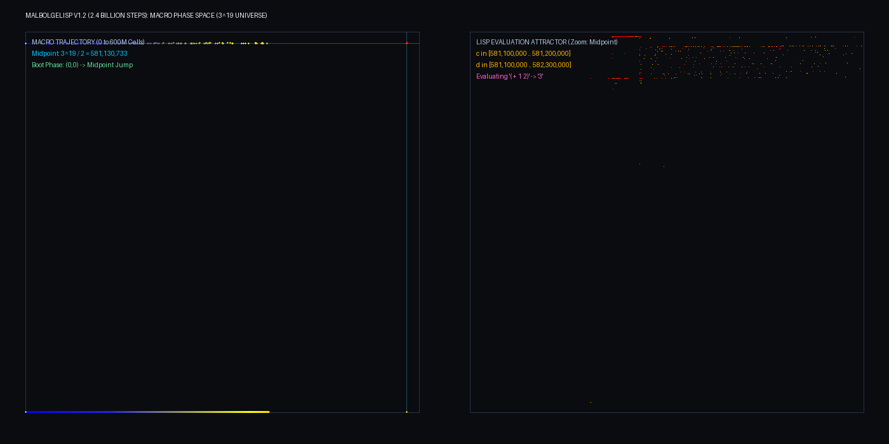 | 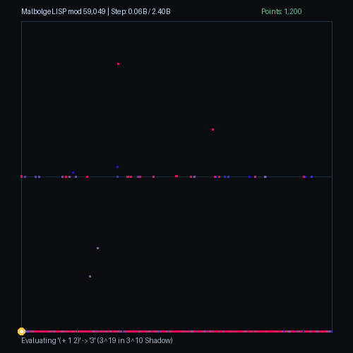 |
| **Salto global desde (0,0) a los 581M y zoom de alta densidad sobre el núcleo de evaluación** | **Trayectoria de 2.4B de pasos plegada sobre la sombra modular del Toroide Clásico** |

---

## 📜 Licencia

MIT License — Copyright (c) 2026 Danny Baanks & ISyCo Research Team.
